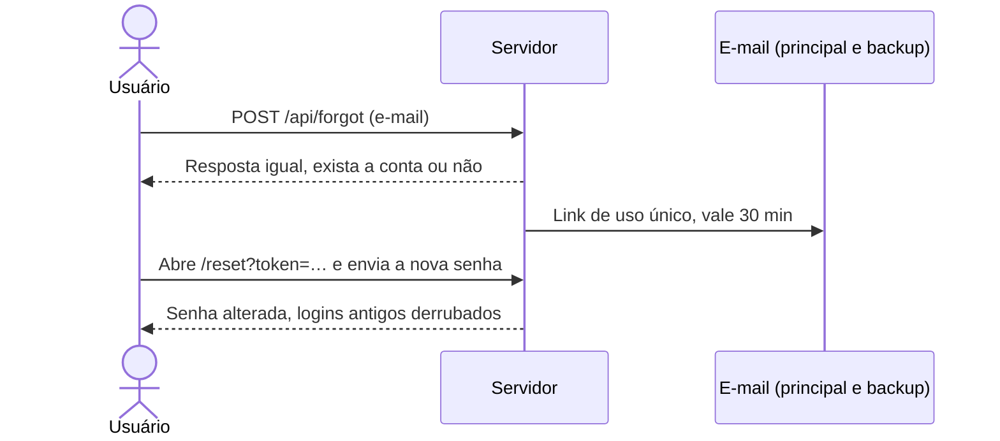

<div align="center">

# 🚀 Evolução & Tecnologia

**Uma linha do tempo interativa da história da tecnologia, com contas de usuário seguras.**

Do primeiro utensílio de pedra à inteligência artificial, em 23 marcos.


</div>

---

## ✨ Destaques

- 🕰️ **Linha do tempo com 23 marcos**, carregados de 6 em 6, com busca (ignora acentos) e filtro por era
- 🎨 **6 temas**: azul escuro (padrão), Preto, Claro, Azul, Verde e Roxo, com a escolha salva no navegador
- 🔐 **Contas seguras**: cadastro, login, logout e recuperação de senha por e-mail
- 📧 **E-mail de backup** opcional para recuperar a conta
- ⚡ **Leve**: front-end em HTML, CSS e JavaScript puros, sem nenhuma biblioteca
- ♿ **Acessível**: link "Ir para o conteúdo", foco visível e anúncios para leitores de tela
- 🧪 **Testado**: 13 testes automáticos com o próprio Node, sem instalar framework de testes

## 🛡️ Segurança

| Proteção | Como funciona |
| --- | --- |
| Senhas | Guardadas só como hash **scrypt** com sal individual, nunca em texto puro |
| Links de e-mail | Confirmação (24 h) e recuperação (30 min), de **uso único**; no disco fica só o SHA-256 do token |
| Tentativas de login | 5 erros bloqueiam por 15 minutos, e há também um limite por IP |
| Sessão | Cookie `HttpOnly` + `SameSite=Strict` (+ `Secure` em produção), válido por 7 dias |
| Requisições de outros sites | Checagem de origem, só aceita JSON e cookie `SameSite=Strict` |
| Cabeçalhos | CSP restrita (sem script ou estilo inline), `X-Frame-Options`, `nosniff`, `Referrer-Policy`, HSTS em produção |
| Privacidade | Cadastro e recuperação respondem igual para e-mails existentes e inexistentes |
| Produção | O servidor **se recusa a iniciar** sem HTTPS e sem e-mail configurado |

## 🧰 Tecnologias

- **Back-end:** Node.js puro (`http`, `crypto`), sem framework
- **E-mail:** [Nodemailer](https://nodemailer.com/) com Gmail (única dependência)
- **Front-end:** HTML, CSS e JavaScript puros
- **Testes:** `node:test`

## 🚀 Como rodar

Você precisa do [Node.js](https://nodejs.org) 20 ou superior.

```bash
# 1. Instale as dependências
npm install

# 2. Rode os testes
npm test

# 3. Crie o arquivo de configuração
cp .env.example .env        # no Windows: copy .env.example .env

# 4. Inicie o servidor
npm start
```

Abra **http://localhost:3000**.

> 💡 Sem `GMAIL_USER` configurado, os e-mails **aparecem no terminal** em vez de serem enviados. Assim dá para testar criar conta e recuperar senha sem configurar nada.

## ⚙️ Configuração (`.env`)

| Variável | Descrição | Padrão |
| --- | --- | --- |
| `NODE_ENV` | `development` ou `production` | `development` |
| `PORT` | Porta do servidor | `3000` |
| `BASE_URL` | Endereço público do site (usado nos links dos e-mails) | `http://localhost:PORT` |
| `TRUST_PROXY` | `1` quando o site roda atrás de um proxy HTTPS | `0` |
| `HOST` | Endereço de escuta (`0.0.0.0` em contêiner) | `127.0.0.1` |
| `GMAIL_USER` | Conta Gmail que envia os e-mails | vazio |
| `GMAIL_APP_PASSWORD` | Senha de app do Gmail | vazio |

### 📬 Configurando o Gmail

1. Ative a **verificação em duas etapas** na sua conta Google
2. Crie uma **senha de app** em [myaccount.google.com/apppasswords](https://myaccount.google.com/apppasswords)
3. Coloque o e-mail em `GMAIL_USER` e a senha de app em `GMAIL_APP_PASSWORD`
4. Crie uma conta de teste e confira se o e-mail chega

## 🗂️ Estrutura

```
evolucao-tecnologia/
├── public/            # Front-end
│   ├── index.html
│   ├── style.css
│   ├── app.js         # Linha do tempo, temas e login
│   └── theme-init.js  # Aplica o tema antes da página aparecer
├── src/               # Back-end
│   ├── server.js      # Ponto de entrada e leitura do .env
│   ├── app.js         # Rotas, cabeçalhos e arquivos estáticos
│   ├── security.js    # Hash de senha, tokens e limite de tentativas
│   ├── store.js       # Armazenamento em JSON
│   └── mailer.js      # Envio de e-mail (Gmail)
├── test/
│   └── auth.test.js
├── data/              # Banco em JSON (fora do Git)
└── .env.example
```

## 🔌 API

| Método | Rota | O que faz |
| --- | --- | --- |
| `POST` | `/api/register` | Cria a conta e envia o link de confirmação |
| `GET` | `/api/confirm?token=…` | Confirma o e-mail (uso único) |
| `POST` | `/api/login` | Entra e cria a sessão |
| `POST` | `/api/logout` | Encerra a sessão |
| `GET` | `/api/me` | Dados do usuário logado |
| `POST` | `/api/forgot` | Envia o link de recuperação |
| `POST` | `/api/reset` | Define a nova senha com o link |

### Fluxo de recuperação de senha



## 🧪 Testes

```bash
npm test
```

Cobrem: hash de senha, cadastro repetido, senha fraca, confirmação e recuperação de uso único, expiração dos links, bloqueio por tentativas, cookies, cabeçalhos de segurança, bloqueio de requisições de outros sites e acesso a arquivos fora da pasta pública.

## 🌐 Publicando

- [ ] `NODE_ENV=production`, `BASE_URL=https://seu-site` e `TRUST_PROXY=1`
- [ ] Servir **apenas por HTTPS**
- [ ] Rodar `npm audit` e corrigir o que aparecer
- [ ] Passar o [OWASP ZAP](https://www.zaproxy.org/) no site já em HTTPS
- [ ] Medir no Lighthouse (Chrome, F12) e testar em celular
- [ ] **Nunca publicar o `.env` nem a pasta `data/`** (já estão no `.gitignore`)
- [ ] Fazer backup do `data/db.json`

## 🗺️ Próximos passos

- Trocar o JSON por um banco de dados (só o `src/store.js` precisa mudar)
- Salvar o tema na conta do usuário
- Mais marcos e mais cores no seletor de tema
- Revisar fatos e datas da linha do tempo

## 🤖 Uso de inteligência artificial

Este projeto foi feito com a ajuda de IA. O assistente **Claude, da Anthropic**, ajudou a escrever e organizar o código, corrigir erros, melhorar a segurança, criar os testes automáticos e redigir esta documentação.

O código passou por testes automáticos, mas **não é uma auditoria de segurança profissional**. Antes de usar com pessoas reais, revise o código, rode `npm audit` e o OWASP ZAP e confira os textos da linha do tempo (fatos e datas), porque a IA também pode errar.
